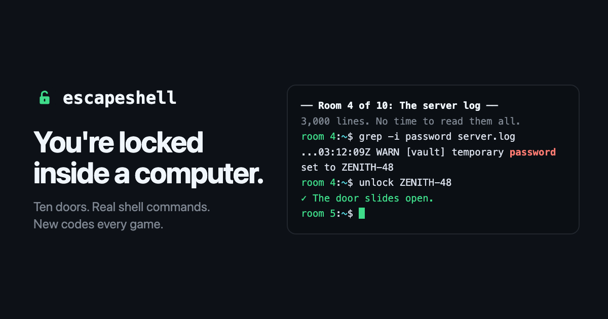

# escapeshell

[](https://github.com/SAMARTHJAISWAL/escapeshell/actions/workflows/ci.yml)
[](https://escapeshell.vercel.app/)
[](LICENSE)

**An escape room in your terminal.** You wake up inside an abandoned observatory computer. Ten doors are locked, and the only tools you have are real shell commands.

```sh
npx github:SAMARTHJAISWAL/escapeshell
```

Or **[play it in your browser](https://escapeshell.vercel.app/)**. You need Node 18 or newer to play in the terminal. Either way, nothing touches your real files: the computer you're trapped in is make-believe.

[](https://escapeshell.vercel.app/)

## How it plays

Every room has a door, and every door has a code. Read, search and filter your way to it, then type `unlock THE-CODE`.

```
── Room 1 of 10: Wake up ──
You wake up in the dark. A single terminal glows in front of you.
This is AURORA-7, an observatory computer that was shut down years ago.
Somehow, you're inside it. Ten locked doors stand between you and the way out.
You'll learn: ls and cat. Type hint if you're stuck.

room 1:~$ ls
note.txt
README.txt
room 1:~$ cat note.txt
Margo's first lesson: always read what's lying around.

The code for this door is NOVA-37
room 1:~$ unlock NOVA-37
✓ The door slides open.
```

It gets harder. In later rooms the code is one line in a 3,000-line log, a count you can only get with a pipe, the most frequent name in a guest book, a column in a CSV, or three fragments hidden across the whole filesystem.

| Room | What you'll use |
|---|---|
| 1. Wake up | `ls`, `cat` |
| 2. Nothing here | hidden files, `ls -a` |
| 3. The maze | `find` |
| 4. The server log | `grep` |
| 5. The knocking | pipes: `grep … \| wc -l` |
| 6. The guest book | `sort \| uniq -c \| sort -rn` |
| 7. The crew list | `grep` and `cut` on a CSV |
| 8. The radio room | `base64 -d` |
| 9. The mirror | `rev` |
| 10. The way out | `grep -r` across the whole system |

Stuck? `hint` gives up to three nudges per room, and `help` and `man grep` explain the commands. Tab completion and the up arrow work like a normal shell.

**Every game is different.** The codes, the files and the answers are generated from a random seed, so you can't copy someone else's answers. When you get out, you get a spoiler-free card to share:

```
🔓 I escaped the terminal in 14:32 · 3 hints · 87 commands
🟩🟩🟩🟨🟩🟧🟩🟩🟩🟩
```

🟩 means no hints in that room, 🟨 one hint, and 🟧 two or more.

## Options

| | |
|---|---|
| `escapeshell` | a new game, with new codes |
| `escapeshell --room 6` | practise one room (no score card) |
| `escapeshell --seed N` | replay a particular game; quitting tells you yours |

In the browser, your game saves as you go, so you can close the tab and come back.

## What's inside

It's zero-dependency JavaScript. The same engine runs in Node and in the browser.

- **[`src/shell.js`](src/shell.js)** is a small shell. It handles quotes and backslashes, `*` `?` `[ ]` wildcards, `~`, pipes, `<`, `;`, `&&` and `||`, and it implements `ls cd pwd cat head tail grep find wc sort uniq cut base64 rev echo tree history man help`. Their options behave like GNU's. One difference: grep patterns are extended regular expressions, as with `grep -E`.
- **[`src/fs.js`](src/fs.js)** is a read-only, in-memory filesystem. `rm`, `sudo` and `vim` get an in-story reply instead.
- **[`src/rooms.js`](src/rooms.js)** builds the ten rooms from a seed.
- **[`src/game.js`](src/game.js)** handles doors, hints, the clock, saving and tab completion.

The tests play 150 complete games through the shell, one per seed. They run each room's intended commands and check the code really appears on screen, so no room can be generated unsolvable. They also cover the shell's parsing and every command, and drive the CLI end to end.

## Development

```sh
npm test         # the shell, the rooms (150 full games) and the CLI
npm run build    # the browser version, into _site/
```

New room ideas are welcome. A good room teaches one command and has a code that a one-liner can find.

## License

[MIT](LICENSE)
